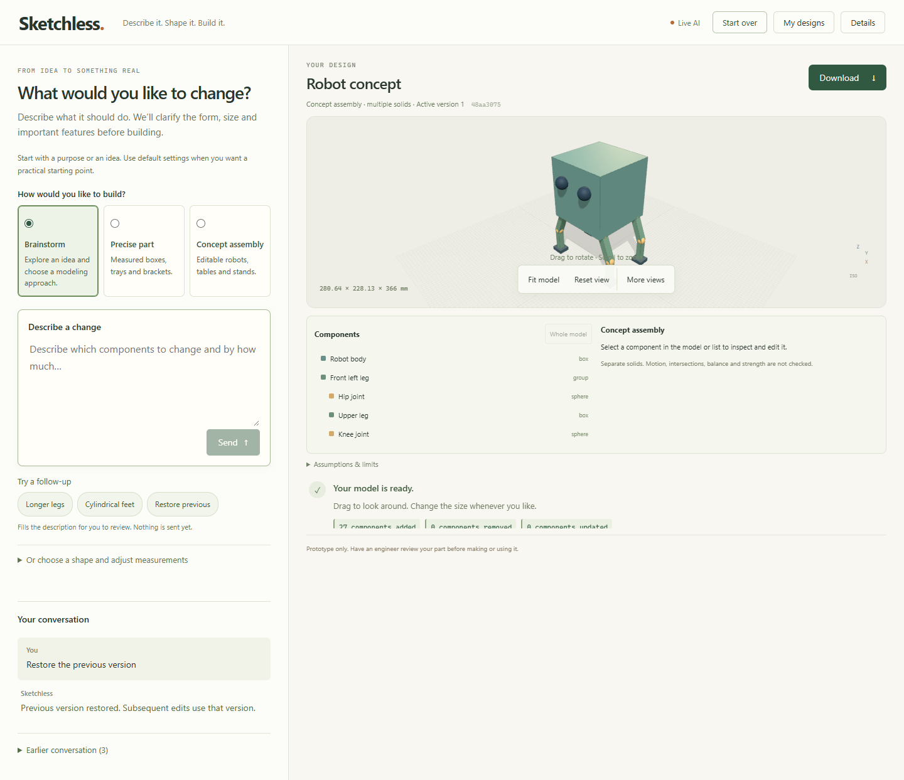

# Sketchless

Sketchless turns a description into a reviewable 3D design, then builds CAD geometry that you can inspect, edit conversationally, restore and export. It is a standalone portfolio project combining a small trained text classifier, the Gemini Developer API and a deterministic geometry engine.

**[Explore saved CAD examples](https://kevincyril.github.io/Sketchless/)** - rotate models, select components and download real CAD files. This gallery works without Gemini; it does not generate new designs.

**Status:** working local application with an independent saved-example gallery. Live AI hosting is pending deployment. Strictly free Render/Neon hosting is being validated; no credit-consuming Azure VM is being provisioned. The Linux container passed CAD/export and persistent-restart checks on a GitHub runner; hosted Azure/Gemini checks remain pending.

Build the service-independent gallery with `npm --prefix frontend run build:gallery`; deploy `frontend/gallery-dist/` as static files. These are saved CAD examples, not live AI output.



## What you can do

- Generate precise open-top enclosures, trays and L-brackets with dimension and solid checks.
- Propose editable concept assemblies built from boxes, cylinders, spheres, cones and groups.
- Answer clarification questions, preview the proposed shapes, send corrections and explicitly approve before concept CAD is built.
- Edit a selected component while preserving the rest of the assembly. Corrections before approval revise the pending proposal.
- Save local designs, reopen conversations, restore immutable successful versions and start over.
- Export STEP/STL; assemblies also provide GLB and editable JSON. Importing JSON rebuilds without an AI call.

Concept assemblies are visual models. They are not verified mechanisms or manufacturing-ready designs. Arbitrary organic models, motion, strength, fit, printability and general product-design quality are not guaranteed.

## Run locally

Requires **64-bit Python 3.12** and **Node.js 22.12+**. From this folder in PowerShell:

```powershell
py -3.12 -m venv .venv
.\.venv\Scripts\python -m pip install -r requirements.txt
npm --prefix frontend ci
npm --prefix frontend run build
if (!(Test-Path .env)) { Copy-Item .env.example .env }
powershell -NoProfile -ExecutionPolicy Bypass -File .\Start-Sketchless.ps1
```

Open **http://127.0.0.1:8000/** and keep the server terminal open. The launcher rebuilds stale frontend assets when dependencies are installed and reuses an already-running Sketchless server. Use `-Port 8001` if needed. These commands preserve the supplied classifier; installation does not retrain it.

A fresh `.env` uses demo mode. The size controls and JSON imports generate actual CAD without credentials. Demo mode does not interpret prose. To use conversational generation, run:

```powershell
powershell -NoProfile -ExecutionPolicy Bypass -File .\Configure-SketchlessAI.ps1
```

The script privately reads your Gemini key and stores it in the ignored backend `.env`. Use an AI Studio Free Tier project with no billing linked; confirm that status when asked. Restart the server afterward. The model is configurable through `GEMINI_MODEL`; there is no paid-provider fallback. Never put the key in frontend variables, source code, screenshots or chat.

Try **Electronics box** for a measured part or **Four-legged robot** for a concept. Send a description, review the assumptions and proposed dimensions, inspect **Preview proposed design**, and select **Build this concept** when ready. Enter adds a newline; only Send submits. Select a component before asking for a scoped change. **Restore the previous version** reactivates saved geometry without another model call.

See the [user walkthrough](docs/try-sketchless.md) for saving, corrections and exports.

## What is trained, generated and deterministic?

| Component | Actual responsibility | What it does not establish |
| --- | --- | --- |
| Trained classifier | TF-IDF word unigrams/bigrams + logistic regression, trained locally on synthetic text, predicts enclosure/tray/bracket for an initial precise-part request. A validation-selected threshold can abstain. | Does not infer dimensions, generate meshes, plan assemblies or measure general intent understanding. |
| Handwritten routing/clarification | Chooses precise/concept workflow and asks some purpose/form/size questions. | This logic is not learned ML; keyword coverage is limited. |
| Gemini Developer API | Interprets descriptions and edits into constrained function calls or clarification text. Receives current scene, selection and conversation context. | Gemini is not trained or fine-tuned by this repository. Valid JSON is not proof of a good design. |
| Pydantic + CAD tools | Validate bounded specs/patches, enforce edit scope, build OpenCascade solids with CadQuery, inspect geometry and produce exports. | Geometry validity does not prove semantic fidelity, physical contact, function or safety. |
| Three.js | Displays actual CAD tessellation after building; renders an explicitly labeled approximate proposal preview before approval. | Proposal preview is not a CAD inspection or connectivity test. |

See [architecture and ML boundaries](docs/architecture.md).

## Reproduce verification

Ordinary tests are offline and never use your local Gemini key:

```powershell
.\.venv\Scripts\python -m pytest tests -q
npm --prefix frontend run build
```

Browser tests start their own offline server on port 8001 with temporary design storage and Gemini transport disabled. They do not use your personal app sessions or API key. The supplied Playwright configuration uses Chrome at `C:/Program Files/Google/Chrome/Application/chrome.exe`; adjust that path for another machine before running:

```powershell
cd frontend
npx playwright test
cd ..
```

Re-evaluate the saved classifier, without training:

```powershell
.\.venv\Scripts\python -m ml.model --evaluate
```

Its existing split has 72 train / 18 validation / 18 test samples, with source groups separated. Recorded perfect synthetic scores are **not real-world accuracy**. The text and paraphrase variants were authored within this project, not independently collected. Only load the project-owned `ml/classifier.joblib`; Joblib files can execute code.

## Fixed modeling evaluation

The versioned suite in `evaluation/modeling_v1.json` contains two development scenarios and six held-out scenarios, with expected dimensions, component edits, preservation and restoration criteria. Dataset and modeling-implementation hashes are frozen in the adjacent lock file. No prompt, classifier or geometry tuning is allowed against that held-out result.

```powershell
# Reproduce v1 in a separate checkout of baseline fc027bb first.
# Current public-safety changes intentionally fail the v1 implementation lock.
# Scripted SDK responses + real API/CAD: verifies wiring, not AI quality.
.\.venv\Scripts\python -m scripts.evaluate_modeling --mode offline --split development
.\.venv\Scripts\python -m scripts.evaluate_modeling --mode offline --split heldout

# Opt-in real Gemini run: at most 12 provider calls, including production repairs.
.\.venv\Scripts\python -m scripts.evaluate_modeling --mode live --split heldout --confirm-free-tier --max-model-calls 12 --min-call-interval 20
```

Live evaluation consumes your free quota. Quota/access failures stop further requests and remain visible as blocked/not-run results. Reports distinguish measured intent checks, geometry checks, exports, API latency, whole-step latency and restore latency. Concept approvals in the runner are explicit harness actions, not automatic product approval. Immutable JSON reports are written under `evaluation/results/`.

**Historical baseline `fc027bb` live snapshot:** 6/6 frozen scenarios passed using 11 real Gemini requests, including five edits and five zero-model-call restorations. This small, project-authored supported-task suite is not general prompt accuracy. Read [evaluation protocol and actual results](docs/evaluation.md). Earlier [design-quality diagnostics](docs/quality-check.md) remain visible, including dimension mismatches and floating parts; they are development examples, not fresh held-out evidence.

## Deployment and limitations

A persistent recruiter-facing link is the deployment goal. See the [hosting comparison](docs/resume-hosting-comparison.md) and [container preparation/status](docs/free-hosting.md). No paid billing has been enabled. Opt-in public mode now isolates anonymous browser sessions and persists application request budgets. See [public-mode configuration, backups and release checklist](docs/public-deployment.md). Linux container validation passed; hosted storage, HTTPS and live Gemini access remain pending. See the [measured Linux report](docs/linux-container-report.json).

The local application uses SQLite and local artifact folders. An opt-in [cloud storage adapter](docs/strictly-free-hosting.md) uses Neon PostgreSQL/private object storage for ephemeral hosts. The backend retains a bounded process-local queue and one active request per session. Use one ASGI worker. A failed build or model request preserves the accepted model. Restarting interrupts in-flight work; it does not resume generation. Portable design JSON retains parameters/components, not conversation history. Back up local designs separately.

The synthetic classifier evaluation and small generation suite do not establish arbitrary prompt success or general design quality. Generated concepts may misinterpret form, placement or dimensions. Free API quotas and free-hosting availability are external limits. API reference: http://127.0.0.1:8000/docs when running locally.

Further details: [concept contract](docs/concepts.md), [workspace behavior](docs/workspace.md), [chronological verification log](docs/verification.txt).
