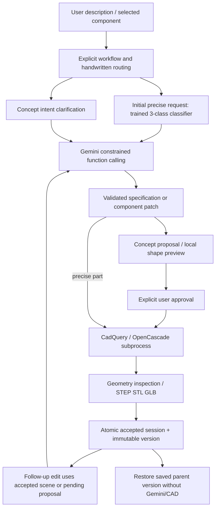

# Architecture and ML boundaries

Sketchless is a standalone conversational modeling/portfolio project. No competition deadline, sponsor integration, group-chat system or additional product track is part of its scope.

## Request flow

## Trained classifier

`ml/model.py` fits a scikit-learn pipeline: TF-IDF word unigrams/bigrams and logistic regression (`C=4`, fixed seed 42). The 108 samples come from 36 project-authored seed groups, each expanded into three mechanical text variants. Whole groups are assigned to train/validation/test (72/18/18 samples). The threshold is selected using validation only, from fixed candidates, with a minimum accepted accuracy requirement and coverage-based selection. Current threshold: 0.45.

The model predicts exactly enclosure, tray or bracket for initial precise requests. For prose requests with no accepted model, an abstention returns clarification before Gemini; accepted category/scores are advisory context for Gemini, not an enforced geometry-family choice. Explicit structured dimensions already identify their family and do not depend on a predicted category for building. It is not a general object classifier. It does not output dimensions, tools, a SceneSpec, CAD code, vertices or assemblies. Scores are uncalibrated probabilities. Abstention is not a comprehensive out-of-domain detector. Handwritten workflow routing selects the concept path separately; it is not this classifier's result.

The held-out classifier test is synthetic and authored in the same development setting as training. A 1.0 score there is not proof of human-language generalization. `--evaluate` loads the saved artifact; training is a separate explicit action. Fixed modeling evaluation does not retrain the classifier or change its threshold.

## Gemini

The backend uses the official `google-genai` SDK against the Gemini Developer API. `GEMINI_API_KEY` remains backend-only. `GEMINI_MODEL` selects an explicitly permitted free-tier model; Free Tier/no-billing attestation is required. Gemini is a pretrained external service: this project neither trains nor fine-tunes it.

Precise interpretation returns a validated part spec or clarification. Concept interpretation uses constrained modeling tools for recipes, custom primitive scenes, component patches or version restoration. The server validates and executes tool actions; model-generated Python never executes. The bounded loop permits up to three interpretation attempts per request including repairs, retains function-call repair context, and stops on provider quota/access errors without a paid fallback.

Current accepted geometry is authoritative for built-model edits. The latest eligible same-base pending proposal becomes the baseline for unapproved corrections. Explicit active-component selection uses the accepted scene. Failed requests preserve accepted geometry; failed corrections can retain their pending baseline for a user-triggered retry. Every conversational concept proposal/edit needs approval before CAD generation.

## Geometry and versions

Pydantic validates sizes, component IDs, primitive types, transforms and hierarchy. Component-only edits must preserve nodes outside the selected subtree. Scenes use millimeters and Z-up coordinates. CadQuery constructs actual OpenCascade solids in a time-bounded subprocess. The backend checks per-component validity, volume, transformed bounds and exports; precise parts have family-specific dimension, cavity and hole checks. The frontend's accepted-model display uses the generated tessellation, not an invented substitute mesh.

These checks do not prove components touch, joints work, a design matches every user intention, or an object is manufacturable/safe. Analytic proposal dimensions and bounding-box separation warnings aid review but do not solve arbitrary semantic validation.

Successful jobs and session pointers publish atomically in SQLite. Successful versions are immutable; restoration switches the accepted pointer to a saved version rather than regenerating. Queue/session locks are local to one backend process, so multi-worker or horizontally scaled deployment needs a different coordination design.

## Evidence categories

- Unit/integration/browser tests with mocked model responses establish application behavior and geometry, not live language capability.
- Classifier metrics measure only its three-class synthetic text task.
- A real Gemini modeling evaluation measures this frozen application on particular prompts and predicates, subject to quota and stochastic responses.
- Previously inspected prompts used to change the app are development/regression evidence. Repeating them is not a new held-out benchmark.

## Public deployment boundary

Optional public mode associates sessions with a hashed anonymous browser cookie, restricts jobs/artifacts to that owner and carries visitor context into queued SDK work. SQLite atomically reserves visitor/network/global call budgets before every SDK request, including repairs, and persists quota cooldowns. This does not train or replace the classifier or Gemini. The historical v1 implementation fingerprint intentionally differs after these infrastructure changes; its score applies to baseline `fc027bb`.

The independently packaged saved-example gallery uses actual public CAD exports without API calls. It is labeled separately from live modeling. Private SQLite/artifact backups are never part of that package. See [deployment and recovery](public-deployment.md).
